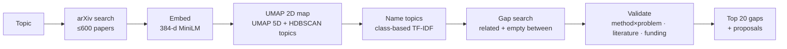
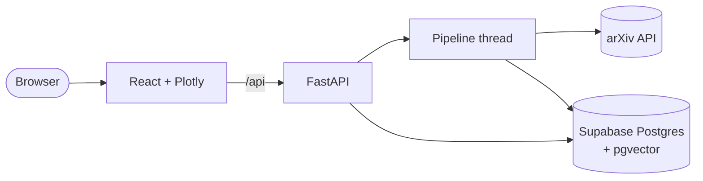

# eXpand: how it works, demo and pitch

> **Theme:** *"New worlds. Open doors to the unexplored, introduce new ideas, or make something no one has seen before."*
>
> **eXpand in one line:** it maps any research field and points at the unexplored space between its topics: real gaps, checked against the literature, ready to become someone's next project.

Contents:
1. [How it works](#1-how-it-works)
2. [How a gap is scored](#2-how-a-gap-is-scored)
3. [Architecture](#3-architecture)
4. [Demo runbook](#4-demo-runbook)
5. [3-minute pitch](#5-3-minute-pitch)
6. [Judge Q&A](#6-judge-qa)

---

## 1. How it works



| # | Step | What happens | Code |
|---|---|---|---|
| 1 | **Search** | The topic becomes an arXiv query where every keyword must be in the abstract (`abs:coral AND abs:reef …`), optionally limited to one category. It takes the 600 most relevant papers, pausing 3 s between requests as arXiv asks. It stops if there are fewer than 150. | `pipeline/ingest.py` |
| 2 | **Embed** | Each paper's `title. abstract` becomes 384 numbers using **all-MiniLM-L6-v2** (runs on the CPU via fastembed). Similar papers get similar numbers. | `pipeline/embed_cluster.py` |
| 3 | **Map** | **UMAP** squashes the 384 numbers to 2 (x, y), for the picture only. The random seed is fixed, so the map looks the same every run. | same |
| 4 | **Cluster** | A second UMAP run reduces to **5 dimensions**, then **HDBSCAN** finds dense groups. These are the sub-topics. The smallest topic is about 1% of the papers (at least 8). Papers that fit no group are "noise". | same |
| 5 | **Name** | **Class-based TF-IDF** picks the words common in one topic and rare in the others, e.g. `planets · habitable zone · climates`. | `llm.py` |
| 6 | **Find gaps** | Score every pair of neighbouring topics by *relatedness × emptiness* (section 2). | `pipeline/gaps.py` |
| 7 | **Validate** | Re-rank by method × problem, how many papers on arXiv already mention both, and funding relevance (section 2). | `pipeline/validation.py` |
| 8 | **Save** | Keep the best 20 gaps, with no topic in more than 3. Each gets a proposal: a research question plus the 3 papers on each side closest to the gap. The map gets a verdict: *clear*, *limited* or *none*. | `pipeline/gaps.py`, `llm.py` |

All the text comes from keywords and templates, not a paid AI service, so it costs nothing and gives the same result every run. Every paper it cites is a real arXiv link.

---

## 2. How a gap is scored

### Base score: is there empty space between two related topics?
All measurements use the full 384-number embeddings, not the 2D picture. The picture distorts distances between far-apart clusters.

1. **Topic centre:** the average embedding of a topic's papers.
2. **Neighbours:** two topics are paired only if each is among the other's **5 most similar** topics.
3. **Relatedness:** the cosine similarity of the two centres.
4. **Emptiness:** walk the straight path between the two centres. At points from 20% to 80% of the way along, count the papers that are "nearby", meaning as close as a typical member is to its own centre. Take the emptiest point:
   `emptiness = 1 − (papers near the emptiest point ÷ papers near the centres)`.
   1 means nothing is there.

```
base_score     = relatedness × emptiness
final_score    = base_score × taxonomy × literature × funding
```

### Validation multipliers

| Check | Rule | Multiplier |
|---|---|---|
| **Taxonomy** | One method + one problem | ×1.0 |
| | One side unclear | ×0.7 |
| | Two methods or two problems | ×0.25 |
| **Literature** (arXiv papers with both topics' key terms in the abstract) | 0 papers: speculative, flagged for a human to check | ×0.5 |
| | 1–4 papers: emerging | ×1.1 |
| | **5–100 papers: "Goldilocks zone"** | **×1.5** |
| | 101–500 papers: established | ×0.85 |
| | Over 500 papers: saturated | ×0.3 |
| **Funding** | Touches a strategic area (energy, materials, oceans & weather, clinical, …) | ×1.1–1.3 |
| | No funding area | ×0.75 (×0.6 if also abstract theory) |

**How a topic is classified as method or problem:** its top 6 keywords vote, using word lists (e.g. "transformer" = method, "flood" = problem). A keyword in neither list is compared with example phrases using the embedding model instead.

**Limits on literature lookups:** only the top 20 candidates are checked. Results are cached in the database, so each query is only sent to arXiv once.

**Verdict for the whole map:**
- **clear:** 3 or more strong gaps;
- **limited:** 1–2 strong gaps;
- **none:** no strong gaps.

A gap is strong if it wasn't penalised and its base score is at least 0.15. A "none" verdict tells the user to try another topic instead of showing weak ideas.

---

## 3. Architecture



| Layer | Choice | Why |
|---|---|---|
| Frontend | React 19, Vite, Plotly.js | A fast, interactive map of thousands of points |
| Backend | FastAPI, one Uvicorn process | Builds run as background jobs. The browser asks for progress every second |
| Database | Supabase Postgres + pgvector | Stores papers, embeddings, topics, gaps and cached literature counts. A Postgres lock means only one build runs at a time, everywhere |
| Machine learning | fastembed, UMAP, scikit-learn HDBSCAN | Runs on a CPU and needs no GPU or API key |
| Hosting | One Docker image on Azure Container Apps | GitHub Actions tests, builds and deploys every push to `main` |

**Fixed seeds:** UMAP's random seed is fixed, so rebuilding a map gives the same map.

**Reuse:** a paper already embedded for another map reuses that embedding.

---

## 4. Demo runbook

### Before you present
- [ ] **Latest version is live:** the deploy has run (Actions tab ✅), and the header says **eXpand**.
- [ ] **Keep the app awake** during judging, so it doesn't take 30 seconds to wake:
  ```bash
  az containerapp update -n gap-finder -g gap-finder-rg --min-replicas 1
  ```
  Set it back to `0` afterwards to save credit.
- [ ] **Tabs open:**
  1. The climate map, showing gap #1: `<live URL>/#climate`
  2. A map with no strong gaps: `<live URL>/#quantum-computing`
  3. A spare tab for building a topic live
- [ ] **Practise the live build:** try your live topic once beforehand, to check it has 150 or more papers. The first build of a topic takes 2–3 minutes, and building it again later is instant. Start it while you speak, or use a topic that's already built as a fallback.
- [ ] **Offline backup:** take screenshots, or record a 30-second screen capture, in case the venue wifi fails.

### Click path (about 90 seconds)

| Step | Show | Say |
|---|---|---|
| 1 | **Climate map** (599 papers, 27 topics) | "Every dot is a real paper, placed by meaning. Colours are sub-topics found automatically." |
| 2 | **Gap #1, the star** | "This star is empty space between two related topics: **climates of habitable-zone exoplanets** and **entropy production in the climate system**. Only 10 arXiv papers mention both, which is right in the Goldilocks zone." |
| 3 | **Gap detail** | Show the score breakdown, the reasons, and the proposal with 3 real papers from each side. Click a paper dot to open its arXiv card. |
| 4 | **Timeline ▶** | "Watch the field grow year by year. Areas fill in, and the gap stays empty." |
| 5 | **Compare table** | All 20 gaps side by side: "7 of 20 are promising. The rest were demoted, and we show why." |
| 6 | **Quantum computing map** | "It also tells you when there's nothing worth pursuing: 17 of 19 candidates demoted. It doesn't make ideas up." |
| 7 | **Search box** | Type a new topic and watch the progress bar: "Any field, about 2 minutes, no AI API, free to run." |

---

## 5. 3-minute pitch

**0:00–0:30, the problem.**
"Every student starting a dissertation, and every researcher hunting for their next project, asks the same question: *what hasn't been done yet?* Today the answer is weeks of reading, and you only find the gaps next to what you already know. The unexplored space between fields is, by definition, the part nobody is looking at."

**0:30–1:00, the idea.**
"eXpand turns a research field into a map. Type any topic. We pull hundreds of papers from arXiv, place each one by meaning, and let the sub-topics form on their own. Then we look for what isn't there: two topics that are closely related, with empty space between them. Those are open doors."

**1:00–2:15, demo.**
Follow the click path above: climate map → gap #1 (exoplanet climates × entropy production, 10 papers) → why it scored well → proposal with real papers → timeline → the honest "none" verdict on quantum computing.

**2:15–2:45, why trust it.**
"An empty space isn't automatically a good idea, so every gap passes three checks:
- Does it pair one *method* with one *problem*?
- Is it in the literature's Goldilocks zone: 5 to 100 papers, not 0 and not 5,000?
- Is there a plausible funding angle?

Every score shows its reasons, and every citation is a real paper. There's no AI writing citations, so none can be made up."

**2:45–3:00, close.**
"It runs on any field, on free tools and a CPU, live on Azure, tested and deployed on every push. eXpand doesn't just show you the map of what's known. It shows you where the new worlds are."

---

## 6. Judge Q&A

**How is this different from Google Scholar, Connected Papers or Elicit?**
Those tools help you find and summarise what *exists*: search results, or the citation neighbourhood around one paper. eXpand looks for what's *missing*: empty space between related topics across a whole field. It then ranks that space by how feasible a project it would be.

**How do you know a gap is real, and not just two groups using different words?**
- **Meaning, not words:** the embeddings capture meaning, so synonyms land close together.
- **A second check:** every top gap is cross-checked by counting the arXiv papers that mention both topics.
- **Zero is flagged:** a count of 0 isn't presented as a discovery. It's marked "needs review", because it may mean a vocabulary mismatch.

**Have you checked that it works?**
- **Tests:** 14 automated tests on made-up data. Empty paths score high, crowded paths score low, topics are paired with their nearest neighbours, and the validation rules apply correctly.
- **Comparison script:** `pipeline/compare_clustering.py` measures how clean the topics are.
- **No real-world ground truth yet.** The natural next step is a **backtest**: build a map from papers before, say, 2018, and check whether the predicted gaps filled up later. The timeline feature already has the data for this.

**Why not use an LLM?**
- **Free:** it costs nothing to run.
- **Repeatable:** the same input always gives the same output.
- **No invented citations:** every paper it cites is real and linked.

An LLM could improve the topic names and proposals later, and the interface in `llm.py` is built to be swapped out.

**Why cluster in 5 dimensions, not on the 2D map?**
- **2D loses too much:** clustering on the picture merges some topics and splits others.
- **384 dimensions is too spread out** for density-based clustering to work.
- **5D works:** it keeps the structure and is still dense enough. The topic-modelling tool BERTopic uses the same approach.

**Why HDBSCAN rather than k-means?**
You don't have to choose the number of topics in advance. It also leaves papers that don't fit as "noise" instead of forcing them into a topic.

**Why only arXiv?**
It has a free, open API and covers CS, physics, maths, quantitative biology and economics. The data source is one module (`ingest.py`), so OpenAlex, Semantic Scholar or PubMed could be added to reach medicine and the humanities.

**Does it scale?**
- **One map:** 600 papers in 2–3 minutes on a single CPU.
- **Many maps:** papers and embeddings are shared between maps, and literature counts are cached.
- **The limit is arXiv's rate limit,** which is why builds take turns.

**How much does it cost to run?**
Almost nothing: the Supabase free tier, CPU-only models, and Azure student credit. The app turns itself off when idle.

**Known limitations: say these before a judge does.**
- **Labels can be odd:** names are built from keywords, so a mixed topic can get a strange label like `ai · justice · particle physics`.
- **Funding check is a word match:** it's a rough proxy and can give a loose match. For example, gap #1 is credited with a "materials" funding area.
- **Narrow searches:** the search only takes the 600 most relevant papers, so very broad fields are sampled, not fully covered.
- **The gap step only shows that the space is empty,** not why. A human still has to judge whether the idea makes sense, and the reasons and paper links are there to help with that.

**Who would use it?**
- final-year and master's students choosing a dissertation;
- PhD applicants writing proposals;
- supervisors suggesting projects;
- research funders and R&D teams scanning for under-explored areas.

**What's next?**
- the backtest described above;
- more data sources;
- LLM-written proposals, grounded in the linked papers;
- following a gap over time, to see if it's closing.
