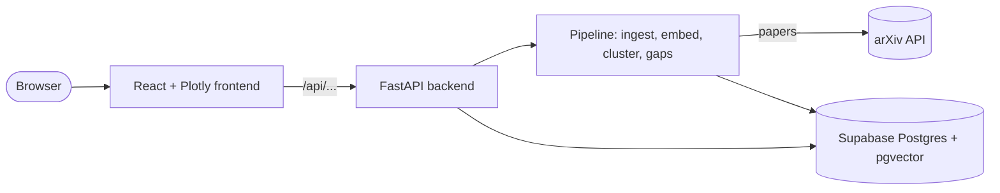
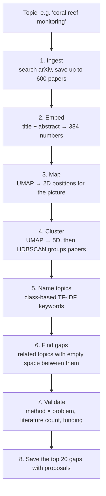

# How Research Gap Finder works

Research Gap Finder takes any research topic, downloads the matching papers from
arXiv, groups them into sub-topics, and looks for **gaps**: pairs of closely
related sub-topics that few papers connect. Each gap comes with a suggested
dissertation idea and a list of papers to start reading.

This document covers three things:

1. [Infrastructure](#1-infrastructure): where the code runs and how the parts talk to each other.
2. [The pipeline](#2-the-pipeline): what happens, step by step, when someone searches for a new topic.
3. [Key algorithms](#3-key-algorithms): the maths behind clustering, gap detection and ranking.

---

## 1. Infrastructure



### The parts

| Part | Technology | Where | What it does |
|---|---|---|---|
| Frontend | React 19, Vite, Plotly.js | `frontend/` | Interactive map, gap list, gap details, comparison table, timeline |
| Backend API | FastAPI + Uvicorn | `api/main.py` | Serves map data and starts topic builds as background jobs |
| Pipeline | Python: fastembed, UMAP, scikit-learn (HDBSCAN), NumPy, pandas | `pipeline/` | Downloads papers, then embeds, clusters and scores them |
| Text generation | scikit-learn (class-based TF-IDF) and templates | `llm.py` | Names topics and writes proposals, without calling any paid AI service |
| Database | Supabase Postgres with the `pgvector` extension | `db.py` | Stores papers, embeddings, clusters, gaps and cached literature counts |
| Alternative UI | Streamlit | `app.py` | A simpler single-file version of the app |

### Database tables (`db.py`)

- **`paper`**: arXiv ID, title, abstract, publication date, and `field` (which topic map it belongs to). After processing, it also holds the 384-number embedding (a `pgvector` column), the paper's x/y map position and its `cluster_id`. The same paper can appear in several maps, so a paper is unique per `(arxiv_id, field)`.
- **`cluster`**: one sub-topic. Holds its label, size, centre on the map, and whether it was classified as a *method* or a *problem domain*.
- **`gap`**: a pair of clusters with its scores, literature count, status (promoted, demoted, …), the reasons behind the score, its map position and the proposal text.
- **`literaturecount`**: a cache of arXiv search counts, so the same query is only ever sent once.

`init_db()` creates any missing tables and upgrades older ones in place. It is safe to run on every start.

### How the backend handles slow builds

A new topic takes a minute or two to build, which is too long for one web request. So:

1. `POST /api/topics` checks the input, starts a **background thread** and returns a `job_id` straight away.
2. The frontend calls `GET /api/jobs/{job_id}` every second, and shows the progress message and bar it gets back.
3. Jobs are kept in the server's memory. This is why the app must run as **a single server process** (one Uvicorn worker, and max 1 replica on Azure).

Only one topic is built at a time across *all* servers, because arXiv limits how fast you may download. This uses a **Postgres advisory lock** (`pipeline_lock` in `pipeline/run.py`): a lock held inside the database, so the API, Streamlit and anyone's laptop all take turns.

| Endpoint | Purpose |
|---|---|
| `GET /api/health` | Uptime check. Doesn't touch the database |
| `GET /api/categories` | arXiv categories a search can be narrowed to |
| `GET /api/topics` | Every map, with paper, cluster and gap counts |
| `GET /api/topics/{field}` | Everything one map needs: papers, clusters, gaps and an overall verdict |
| `POST /api/topics` | Start building a topic |
| `GET /api/jobs/{job_id}` | Progress of a build |

### Running and hosting

- **Local development**: Uvicorn on port 8000 and the Vite dev server on port 5173. Vite forwards `/api` requests to port 8000 (`frontend/vite.config.js`).
- **One container**: the `Dockerfile` builds the React app with Node, then copies the result into a Python image. FastAPI serves both the API and the built frontend on port 7860. The embedding model is downloaded during the image build, so the first search doesn't have to wait for it.
- **Azure Container Apps**: `.github/workflows/build-image.yml` builds the image on every push to `main` and publishes it to `ghcr.io/cchan083/whack-2026`. Azure then runs that image. Azure for Students can't build images itself, which is why GitHub does it. The database URL is stored as an Azure secret.
- **Hugging Face Spaces** (alternative): `deploy-huggingface.yml` pushes the repo to a Space, which builds the same Dockerfile.
- **GitHub Pages** (frontend only): `deploy-pages.yml` builds the frontend with `VITE_API_URL` pointing at a hosted backend.

---

## 2. The pipeline

`pipeline/run.py → run_topic()` runs these steps in order. Each step reports progress, which drives the progress bar in the UI.



### Step 1: Ingest (`pipeline/ingest.py`)
- **Search**: the topic becomes an arXiv query in which every keyword must appear in the abstract. `"coral reef monitoring"` → `abs:coral AND abs:reef AND abs:monitoring`. Common words like "the" are dropped, and the search can be narrowed to a category (e.g. `cat:cs.LG`).
- **Download**: the 600 most relevant papers are fetched, with 3 seconds between requests as arXiv's rules require. They are saved in batches of 100, so an interrupted download keeps what it already got.
- **Too few papers**: under 150 papers gives a meaningless map, so the build stops and suggests a broader topic.

### Step 2: Embed (`pipeline/embed_cluster.py`)
- **The model**: each paper's `title. abstract` goes through **all-MiniLM-L6-v2**, a small sentence-embedding model run on the CPU with `fastembed`. It turns text into 384 numbers. Papers about similar things end up with similar numbers.
- **Reuse**: a paper that was already embedded for another topic reuses that embedding, and only papers without one are processed. Re-runs are therefore quick.

### Step 3: Map
**UMAP** squashes the 384 numbers down to 2 (x, y), keeping papers that are similar close together. This layout is only for the picture. Settings: cosine distance, 15 neighbours, a fixed random seed so the map looks the same every run.

### Step 4: Cluster
- **Why 5D**: a second UMAP run reduces the embeddings to **5 dimensions**, and **HDBSCAN** finds the groups in that space. Clustering in 2D loses too much (some topics merge, others split), while 384D is too spread out for density-based clustering. 5D is the middle ground used by BERTopic.
- **Smallest topic**: about 1% of the papers, and never fewer than 8.
- **Noise**: papers that don't fit any group become "noise". They are drawn on the map but belong to no topic.

### Step 5: Name topics (`llm.py`)
- **Labels**: each topic gets its most *distinctive* keywords (see [class-based TF-IDF](#class-based-tf-idf-topic-names)) and is labelled with its top three, e.g. `flood forecasting · rainfall · lstm`.
- **Saving**: the old clusters and gaps for this topic are replaced in one database transaction, so the database never holds a half-old, half-new map.

### Steps 6–8: Gaps, validation and proposals (`pipeline/gaps.py`, `pipeline/validation.py`)
- **Find and rank**: candidate gaps are found and scored, then re-ranked by the validation checks (section 3).
- **Variety**: the best 20 are kept, with no topic appearing in more than 3 gaps, so one central topic can't fill the list.
- **Proposals**: for each saved gap, `llm.write_proposal()` writes a short dissertation idea. It includes a research question chosen from a few templates, plus the 3 papers on each side that sit closest to the gap, as starting reading.

### Re-running
- **Redo topics and gaps**: `python -m pipeline.run --recluster --field <field>` (or `--all`) uses the current code without downloading papers again.
- **Compare clusterings**: `pipeline/compare_clustering.py` compares the saved clustering with what the current code would produce, without changing anything.

---

## 3. Key algorithms

### Embeddings and cosine similarity
- **Embedding**: a list of 384 numbers that describes what a paper is about.
- **Cosine similarity**: two papers are compared by the angle between their embeddings. 1 means the same direction (same subject), and around 0 means unrelated.
- **Where it's used**: every distance in the gap step uses cosine similarity in the full 384-number space, not positions on the 2D map. UMAP keeps neighbours together, but distances between far-apart clusters on the map don't mean much.

### UMAP (dimensionality reduction)
UMAP builds a graph linking each paper to its 15 most similar papers. It then lays the papers out in fewer dimensions so that the same links stay short. It's used twice:
- **For the picture**: 2D with `min_dist=0.05`, so dots don't pile on top of each other.
- **For clustering**: 5D with `min_dist=0`, which packs similar papers tightly so groups are easier to find.

### HDBSCAN (clustering)
HDBSCAN finds groups as **dense regions** of points, separated by sparser space.
- **No set number of topics**: unlike k-means, you don't choose how many topics there are. It finds as many as the data supports.
- **Noise**: papers in sparse areas are labelled noise instead of being forced into a topic.
- **Settings**: `min_cluster_size` (about 1% of papers) sets the smallest topic, and `min_samples=2` controls how strict it is.

### Class-based TF-IDF (topic names)
- **Method**: each cluster's text is joined into one big document. Then each word or two-word phrase is scored as:
  ```
  score = (how often the term appears in this cluster) × log(1 + average cluster size / how often it appears in all clusters)
  ```
  A high score means the term is common in this cluster but rare in the others.
- **Clean-up rules**:
  - Remove common filler and general machine-learning words ("propose", "model", "neural", …).
  - In maps with 5 or more clusters, ignore words found in more than half of them, since those describe the whole field.
  - Merge near-duplicates ("flood" / "floods").
  - Prefer a frequent two-word phrase over its single word ("flow" → "flow matching").

### Gap detection (`candidate_pairs` in `pipeline/gaps.py`)
A gap is two **related** topics with **empty space** between them.

1. **Topic centres**: the average embedding of each topic. "Nearby" means as similar as a typical (median) member is to its own centre.
2. **Pair neighbouring topics**: two topics are linked only if **each is in the other's 5 most similar topics**. Requiring it both ways stops an odd one-off topic being paired with whichever topic is least unrelated to it.
3. **Emptiness**: walk along the straight path between the two centres, checking points between 20% and 80% of the way. At each point, count the papers nearby. Take the emptiest point and compare its count with how crowded the two centres are:
   ```
   emptiness = 1 − (papers near the emptiest point / papers near the centres)
   ```
   1.0 means nothing is there, and 0.0 means it's as crowded as the topics themselves. Comparing the path with the *centres*, not with single papers, keeps the comparison fair. In 384 dimensions, an average sits closer to everything than any single paper does.
4. **Relatedness**: the cosine similarity of the two topic centres.
5. **Base score**:
   ```
   base_score = relatedness × emptiness
   ```
6. **The star on the map**: the gap is drawn the same fraction of the way along the 2D line between the two clusters, so it sits on the line shown in the UI.

### Validation: is the gap a feasible project? (`pipeline/validation.py`)
A high base score alone can still give a poor project idea: two methods with no problem ("LLMs × GANs"), an already crowded area, or something nobody would fund. Three checks each multiply the score and record a human-readable reason:

```
final_score = base_score × taxonomy × literature × funding
```

**1. Taxonomy: method vs problem.** A good project applies exactly one method to one problem.
- **How each topic is classified**:
  - Its top 6 keywords vote "method" (+1) or "problem" (−1), with more distinctive keywords counting more.
  - The votes come from hand-written word lists: methods like "transformer", "bayesian", "reinforcement"; problems like "flood", "crop", "protein".
  - A keyword in neither list is compared with example phrases using the embedding model. Its vote counts a bit less (×0.6).
- **Multipliers**:

| Pair | Multiplier |
|---|---|
| Method × problem | ×1.0 |
| One topic unclear | ×0.7 |
| Two methods or two problems | ×0.25, or rejected in strict mode |

**2. Literature density ("Goldilocks zone").**
- **How it's measured**: arXiv is asked how many papers mention both topics' key terms (`abs:"A" AND abs:"B"`). Only the total count is fetched.
- **Limits**: only the top 20 candidates are checked, with 3 seconds between requests. Results are cached in the database, and the lookup backs off when arXiv says "too many requests".
- **Multipliers**:

| Papers mentioning both | Meaning | Multiplier |
|---|---|---|
| 0 | Speculative: flagged for a person to check | ×0.5 |
| 1–4 | Emerging | ×1.1 |
| 5–100 | Goldilocks zone | ×1.5 |
| 101–500 | Established | ×0.85 |
| over 500 | Saturated | ×0.3 |

**3. Funding / usefulness.** Does either topic touch a strategic funding area, such as energy grids, semiconductors, materials or clinical biotech?
- **A match** applies that area's weight as a bonus.
- **No match** gives ×0.75.
- **Abstract theory** with no applied angle gets a further ×0.8.

**Status**: each gap is labelled *promoted* (net change ≥ ×1.1), *demoted* (≤ ×0.9), *neutral*, *needs review*, or *rejected*. Its reasons are saved and shown in the UI.

**Topic verdict** (`assess_topic`): a gap is "strong" if it wasn't penalised and its base score is at least 0.15. The map is then rated:

| Verdict | Meaning |
|---|---|
| **clear** | 3 or more strong gaps |
| **limited** | 1–2 strong gaps |
| **none** | No strong gaps. The UI suggests a broader topic |

---

## 4. The frontend

`frontend/src/App.jsx` holds the state and arranges these components:

| Component | What it shows |
|---|---|
| `TopicSearch` / `TopicSwitcher` | Build a new topic or open an existing one |
| `MapView` | The Plotly scatter map: papers coloured by topic, the selected gap's two topics highlighted, gaps drawn as stars on the line between topics, and paper cards with arXiv links on click |
| `GapList` / `GapDetail` | Ranked gaps, plus the selected gap's proposal, reasons and reading list |
| `GapTable` | Side-by-side comparison of all gaps |
| `Timeline` | Plays the map year by year to show how the field grew |
| `VerdictNotice` | The clear / limited / none verdict |

**Helpers in `frontend/src/lib/`:**
- `score.js` rebuilds the score breakdown bars, using copies of the backend's thresholds. If you change `validation.py`, keep this file in sync.
- `mapNav.js` handles zooming and flying to a point on the map.
- `hash.js` stores the open topic in the URL, so links can be shared.

---

## 5. Tests

`tests/` uses small made-up data, so no database or network is needed:
- `test_gaps_geometry.py` checks the gap geometry:
  - an empty path between topics scores high, and a path full of bridging papers scores low;
  - the gap's star sits on the line between the two topics;
  - topics are only paired when each is in the other's most similar list;
  - 5D clustering separates distinct topics correctly.
- `test_validation.py` checks the method/problem classification, the literature and funding multipliers, and the topic verdict. It uses `MockLiteratureCounter` instead of calling arXiv.
